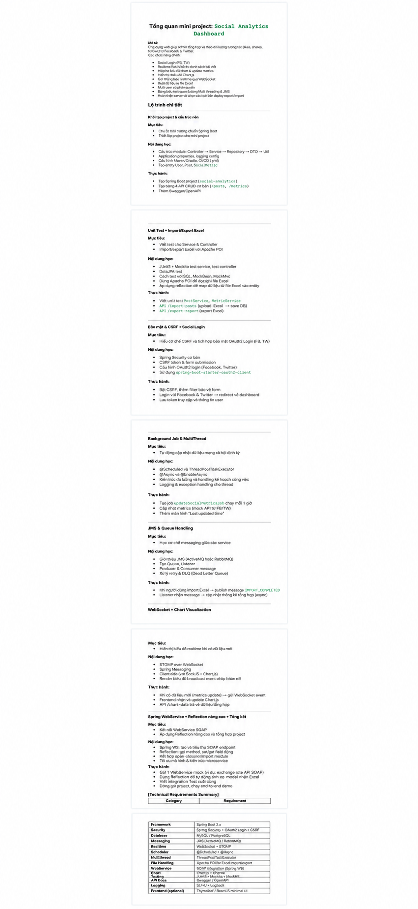
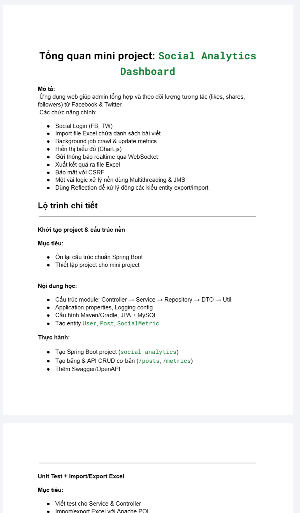
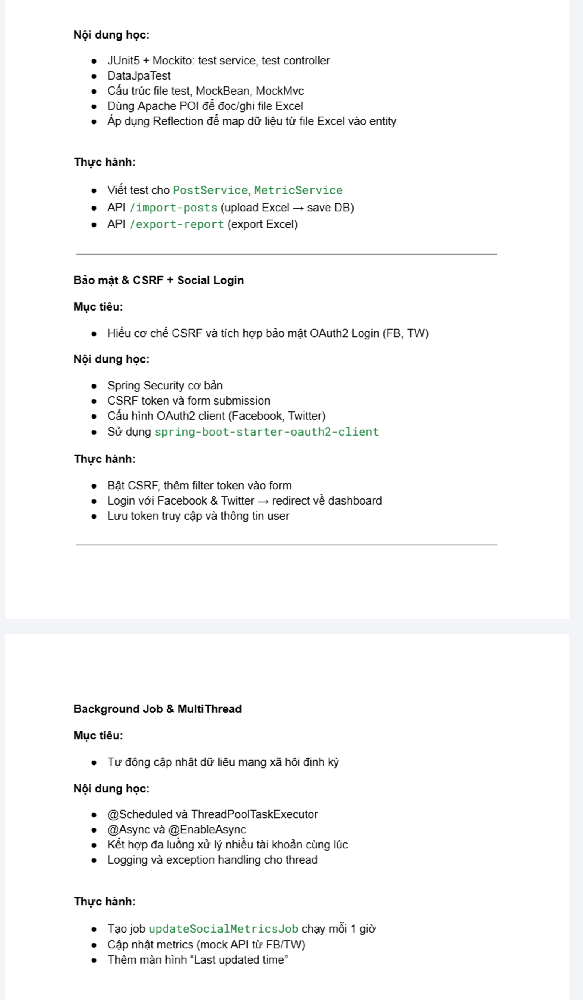
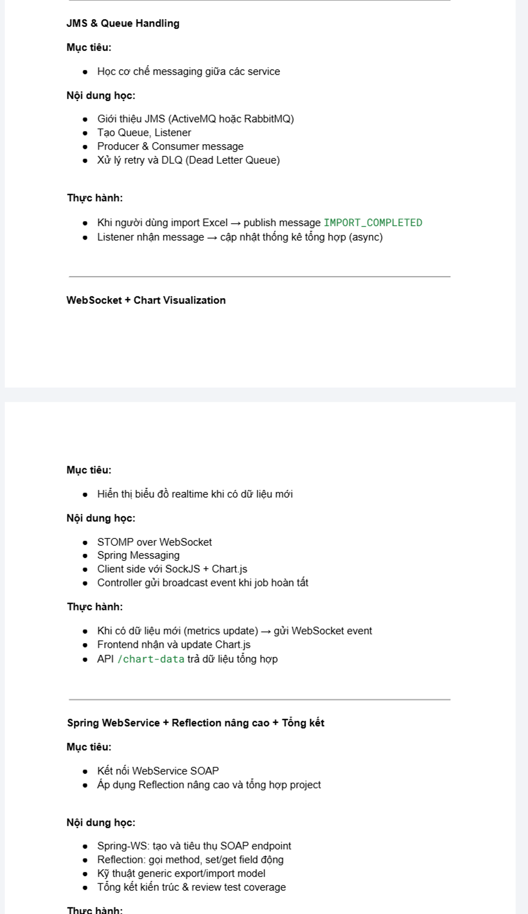
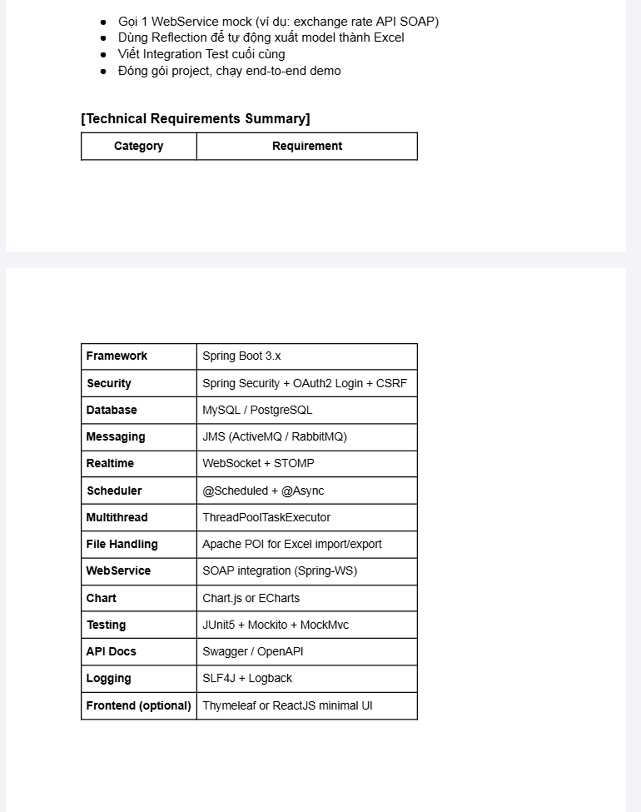

# Social Analytics Dashboard — Requirements

## Ảnh tham chiếu đã crop

Ảnh tổng hợp:

Ảnh phóng lớn theo từng trang (4 trang):

1. 
2. 
3. 
4. 

## 1. Tổng quan

### Mô tả

Xây dựng web application để tổng hợp, theo dõi và phân tích dữ liệu từ các nền tảng mạng xã hội, gồm lượt thích, lượt chia sẻ, lượt theo dõi và các chỉ số tương tự từ Facebook và Twitter.

### Mục tiêu học tập

- Ôn lại cấu trúc và cách tổ chức một dự án Spring Boot.
- Kết hợp REST API, cơ sở dữ liệu, bảo mật, xử lý nền, messaging, realtime và kiểm thử trong một mini-project.

### Phạm vi chức năng chính

- Đăng nhập mạng xã hội bằng Facebook và Twitter.
- Import danh sách bài viết từ file Excel.
- Lưu và cập nhật metrics cho bài viết.
- Chạy background job để crawl hoặc cập nhật metrics định kỳ.
- Hiển thị dữ liệu bằng biểu đồ.
- Export báo cáo ra file Excel.
- Thông báo lỗi khi gọi API mạng xã hội thất bại.
- Xử lý nền bằng multithreading và JMS.
- Dùng Reflection để tự động ánh xạ dữ liệu entity/model khi import và export.

## 2. Lộ trình và yêu cầu theo giai đoạn

### 2.1. Khởi tạo project và chạy nền

**Yêu cầu:**

- Tổ chức code theo luồng `Controller → Service → Repository → DTO → Unit`.
- Cấu hình `application.properties`, gồm logging và các cấu hình ứng dụng.
- Cấu hình Hibernate/JPA và cơ sở dữ liệu MySQL hoặc PostgreSQL.
- Tạo các entity cơ bản: `User`, `Post`, `SocialMetric`.
- Khởi tạo Spring Boot project với tên `social-analytics`.
- Tạo bảng và REST API CRUD cơ bản cho `posts` và `metrics`.
- Thiết lập Swagger/OpenAPI.

### 2.2. Unit test và import/export Excel

**Mục tiêu:** Viết test cho service/controller và hỗ trợ import/export Excel bằng Apache POI.

**Yêu cầu:**

- Sử dụng JUnit 5 và Mockito để test service, controller.
- Sử dụng `@DataJpaTest` và MockMvc ở các lớp phù hợp.
- Đọc và ghi file Excel bằng Apache POI.
- Dùng Reflection để ánh xạ dữ liệu từ Excel vào entity.
- Viết test cho `PostService` và `MetricService`.
- Cung cấp API `/import-posts` để upload Excel và lưu dữ liệu vào database.
- Cung cấp API `/export-report` để export báo cáo ra Excel.

### 2.3. Bảo mật, CSRF và social login

**Mục tiêu:** Hiểu cơ chế CSRF và tích hợp OAuth2 Login cho Facebook/Twitter.

**Yêu cầu:**

- Cấu hình Spring Security cơ bản.
- Bật và xử lý CSRF token trong form/request phù hợp.
- Tích hợp OAuth2 Login với Facebook và Twitter.
- Cấu hình Spring Boot OAuth2 client starter.
- Sau khi đăng nhập, redirect người dùng về dashboard.
- Lưu access token và thông tin người dùng theo thiết kế bảo mật của ứng dụng.

### 2.4. Background job và multithreading

**Mục tiêu:** Tự động cập nhật metrics theo định kỳ.

**Yêu cầu:**

- Sử dụng `@Scheduled` để lập lịch.
- Cấu hình `ThreadPoolTaskExecutor`.
- Sử dụng `@Async` và `@EnableAsync`.
- Kết hợp đa luồng để xử lý nhiều tài khoản.
- Có logging và exception handling riêng cho các luồng xử lý.
- Tạo job `updateSocialMetricsJob` chạy mỗi giờ.
- Cập nhật metrics từ API Facebook/Twitter; giai đoạn đầu có thể dùng mock API.
- Hiển thị hoặc lưu nhãn `last updated`.

### 2.5. JMS và queue handling

**Mục tiêu:** Trao đổi message giữa các service hoặc thành phần xử lý.

**Yêu cầu:**

- Hỗ trợ JMS với ActiveMQ hoặc RabbitMQ.
- Tạo queue và listener.
- Triển khai producer và consumer message.
- Có cơ chế retry và Dead Letter Queue (DLQ).
- Khi người dùng import Excel thành công, publish message `IMPORT_COMPLETED`.
- Listener nhận message và cập nhật thống kê tổng hợp theo cách đồng bộ.

### 2.6. WebSocket và biểu đồ realtime

**Mục tiêu:** Hiển thị dữ liệu realtime khi có metrics mới.

**Yêu cầu:**

- Sử dụng STOMP over WebSocket.
- Sử dụng Spring Messaging.
- Client sử dụng SockJS và Chart.js.
- Controller broadcast dữ liệu biểu đồ khi background job hoàn tất.
- Khi metrics được cập nhật, phát WebSocket event.
- Frontend nhận event và cập nhật biểu đồ Chart.js.
- Cung cấp API `/chart-data` để tải dữ liệu tổng hợp.

### 2.7. Spring WebService, Reflection nâng cao và tổng kết

**Mục tiêu:** Kết nối SOAP WebService và áp dụng Reflection nâng cao trong toàn project.

**Yêu cầu:**

- Tạo và sử dụng SOAP endpoint bằng Spring-WS.
- Định nghĩa XML mapping và schema.
- Áp dụng kỹ thuật generic Reflection.
- Gọi mock WebService, ví dụ exchange-rate API SOAP.
- Tự động map model thành Excel bằng Reflection.
- Viết integration test cho SOAP endpoint.
- Đánh giá kiến trúc, test coverage và checklist end-to-end.

## 3. Yêu cầu kỹ thuật

| Hạng mục | Yêu cầu |
| --- | --- |
| Framework | Spring Boot 3.x |
| Security | Spring Security, OAuth2 Login, CSRF |
| Database | MySQL hoặc PostgreSQL |
| Messaging | JMS, ActiveMQ hoặc RabbitMQ |
| Realtime | WebSocket, STOMP |
| Scheduler | `@Scheduled`, `@Async` |
| Multithreading | `ThreadPoolTaskExecutor` |
| File handling | Apache POI cho Excel import/export |
| WebService | SOAP integration bằng Spring-WS |
| Chart | Chart.js hoặc ECharts |
| Testing | JUnit 5, Mockito, MockMvc |
| API documentation | Swagger/OpenAPI |
| Logging | SLF4J, Logback |
| Frontend (tùy chọn) | Thymeleaf hoặc ReactJS với UI tối thiểu |

## 4. Tiêu chí hoàn thành

- Có thể đăng nhập bằng Facebook/Twitter và quay về dashboard.
- Có thể import bài viết từ Excel, lưu vào database và phát message `IMPORT_COMPLETED`.
- Có thể cập nhật metrics theo lịch và ghi nhận thời điểm cập nhật gần nhất.
- Có thể xem dữ liệu tổng hợp qua API và biểu đồ realtime.
- Có thể export báo cáo ra Excel.
- Có xử lý lỗi, retry và DLQ cho các luồng bất đồng bộ phù hợp.
- Có unit test cho service/controller, integration test cho SOAP endpoint và tài liệu API.

## 5. Ghi chú nguồn

Tài liệu này được chép từ phần nội dung chính bên phải của ảnh tham chiếu. Sidebar/thumbnail bên trái đã được bỏ qua. Các lựa chọn còn để mở trong ảnh — chẳng hạn MySQL hoặc PostgreSQL, ActiveMQ hoặc RabbitMQ, Chart.js hoặc ECharts — được giữ nguyên dưới dạng lựa chọn, không tự quyết định thay cho dự án.
