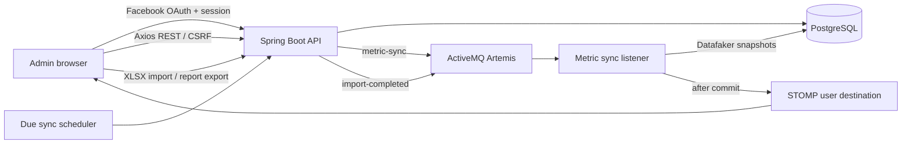

# System Architecture

## Runtime components

- **Next.js frontend** (`frontend/`): App Router login/dashboard UI, Axios browser client, TanStack Query remote data cache, Zustand transient chart-range state, a Chart.js combo visualization (engagement bars plus a followers trend on a secondary axis), and STOMP/SockJS updates.
- **Spring Boot backend**: Facebook OAuth2 login and session security, REST APIs, Excel processing, synthetic metric generation, scheduled dispatch, JMS consumers, WebSocket notifications, and a typed SOAP demo endpoint.
- **PostgreSQL**: source of truth for admins, posts, crawl settings, sync runs, and append-only metric snapshots. Flyway owns schema evolution.
- **ActiveMQ Artemis**: queues metric generation jobs and import-completion events.

## Data flow

## Backend package-by-layer

Java packages are arranged by technical layer under `com.learning.socialanalytics`: `config`, `constants`, `controller`, `dto`, `endpoint`, `entity`, `exception`, `listener`, `repository`, `scheduler`, `service`, and `util`. REST and SOAP adapters delegate to services; JPA entities never cross the API boundary.

## Frontend feature-based layers

`frontend/src/features/` contains `auth`, `dashboard`, and `posts`, each split into `api`, `components`, `hooks`, and `model`. `shared` owns constants and the Axios client; `providers` owns TanStack Query and toast providers. Custom-authored `.tsx` components use PascalCase names and filenames. Next.js route files and generated shadcn primitives keep framework/registry names.

## Identity and access

Facebook is the sole login provider. The backend persists the Facebook subject, name, optional email, and picture URL, and uses an HTTP session. Access/refresh tokens are not stored because this iteration does not call Facebook APIs. CSRF remains enabled for unsafe browser requests. Each data query is scoped to the authenticated Facebook subject's internal admin ID. STOMP uses the authenticated HTTP session and `/user/queue/metrics`.

## Metrics and scheduling

Each administrator stores an interval in minutes (1–1,440), an enabled flag, and last/next run timestamps in UTC. A one-minute dispatcher enqueues due work. Manual and scheduled runs share a persisted `SyncRun` and JMS message. The listener creates a new Datafaker snapshot per active post in one database transaction, completes the run, updates the schedule, then sends a private WebSocket event after commit. Synthetic metrics are not Facebook-reported measurements.

## File and integration boundaries

Excel import accepts `.xlsx` up to 10 MiB / 5,000 data rows and requires a `post_url` column; optional `title` values label posts. The report exports the latest 100 owner-scoped snapshots. The reflection mapper accepts only the allow-listed `MetricExportRow` DTO and annotated primitive/string fields. Spring-WS exposes a local exchange-rate demo at `/soap/mockExchangeRate.wsdl`.

## Operational limits

The included scheduler and in-memory STOMP simple broker target a single application instance. Horizontal scaling requires atomic due-work claiming and a shared STOMP broker relay. Configure real Meta credentials, HTTPS secure cookies, database/broker secrets, and external monitoring before deployment.
